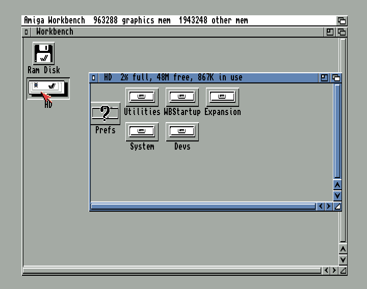
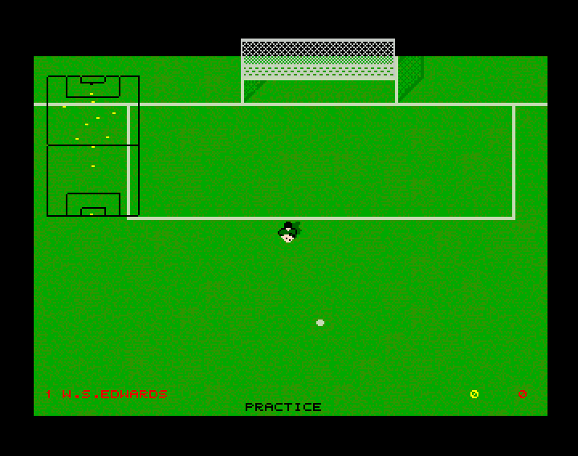
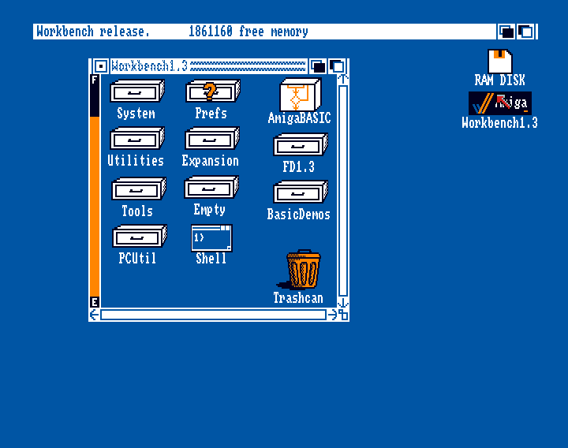
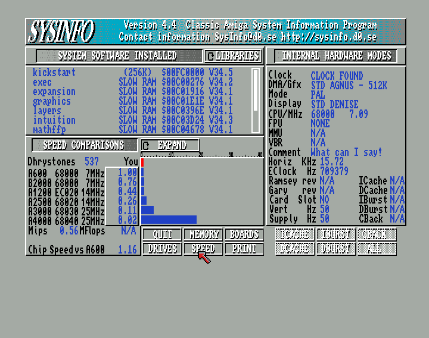
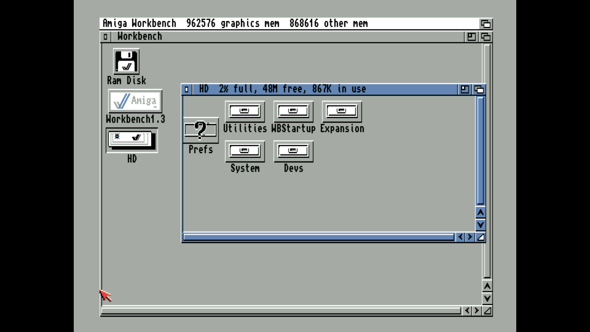
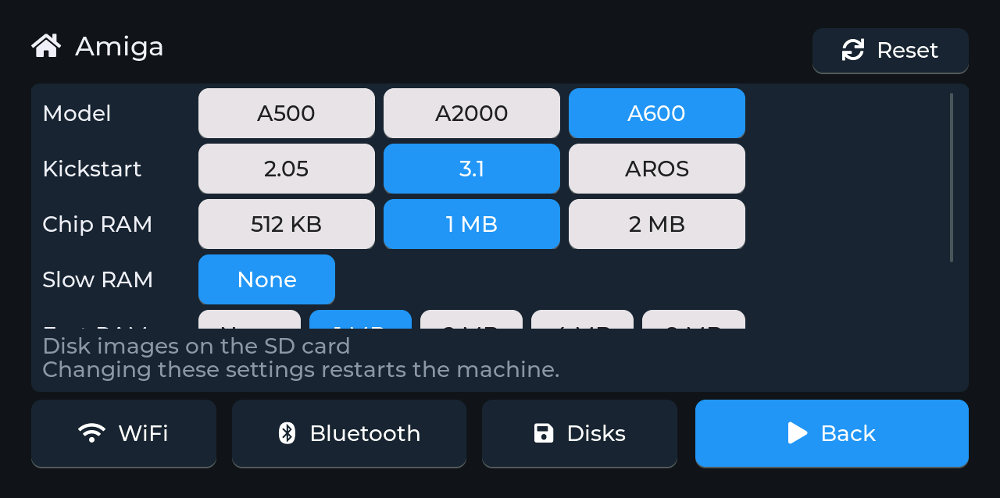
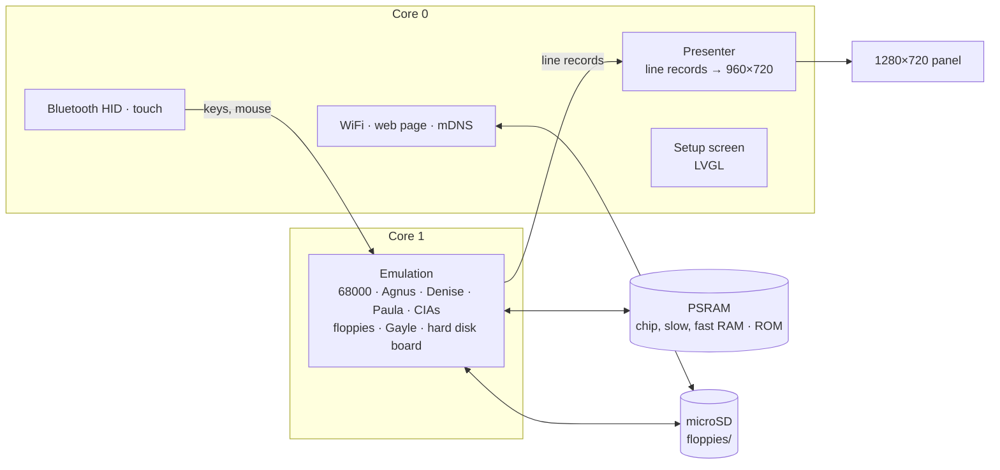
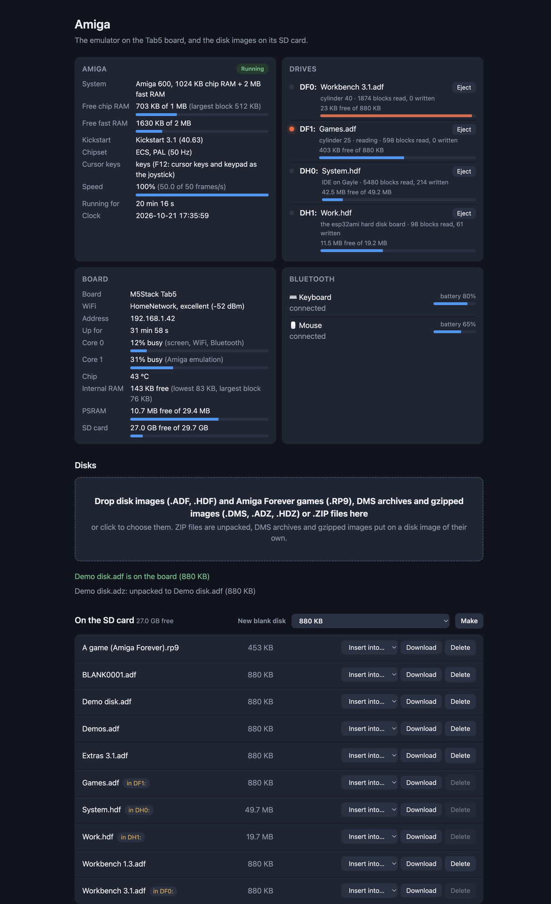
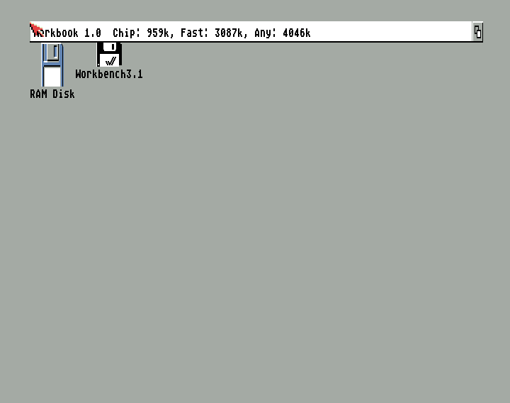

<h1 align="center">esp32ami</h1>

<p align="center">
  <b>A Commodore Amiga 500, 2000 or 600 on an M5Stack Tab5.</b><br>
  A 68000 at 7.09 MHz with the OCS and ECS chipsets (Agnus, Denise, Paula, two 8520 CIAs), Kickstart 1.2 to 3.1 or the free AROS, floppy and hard disk images, the A600's IDE port, fast RAM, Bluetooth keyboard and mouse, the touch screen as a touchpad.
</p>

<p align="center">
  
  
  
  
  
</p>

<p align="center">
  <b>Work in progress:</b> not everything has been tested, and games and demos may or may not
  work satisfactorily.
</p>

<p align="center">
  
  
  <br>
  
  
  <br>
  <sub>Workbench 3.1 on an A600 and Workbench 1.3.5 on an A500, both from hard disk images; Kick Off 2
  from its Amiga Forever package; SysInfo measuring the A500 as fast as an A600. From the desktop
  build of the same emulator (<code>components/amiga/host</code>).</sub>
</p>

esp32ami turns an M5Stack Tab5 into a Commodore Amiga, chosen on its setup
screen: the **A500** (with its 512 KB trapdoor "slow RAM"), the **A2000**
(with fast RAM on a Zorro II board) or the **A600** (ECS, up to 2 MB chip
RAM, the IDE port), each with the Kickstart of your choice: **1.2**,
**1.3**, **2.04**, **2.05**, **3.1**, or **AROS**, the free one, which needs
no Commodore ROM at all. Floppy and hard disk images on the microSD card go
into two floppy drives and two hard disks, Amiga Forever's game packages
included; a Bluetooth keyboard and mouse (or your finger on the screen)
work the Workbench and the games, and a setup screen on the touch panel,
and a web page on your network, handle everything else.

It's a sibling of
[esp32ste](https://github.com/rlucencic/esp32ste) (Atari STE),
[esp32mac](https://github.com/rlucencic/esp32mac) (Macintosh Plus, SE, Classic),
[esp32mac2](https://github.com/rlucencic/esp32mac2) (Macintosh LC and II),
[esp32mac3](https://github.com/rlucencic/esp32mac3) (Macintosh LC II and LC III),
[esp32cpc](https://github.com/rlucencic/esp32cpc) (Amstrad CPC),
[esp32zx](https://github.com/rlucencic/esp32zx) (ZX Spectrum),
[esp32cbm](https://github.com/rlucencic/esp32cbm) (Commodore 64 and 128),
[esp32xl](https://github.com/rlucencic/esp32xl) (Atari 800XL and 130XE),
[esp32msx](https://github.com/rlucencic/esp32msx) (MSX1 and MSX2),
[esp32gs](https://github.com/rlucencic/esp32gs) (Apple IIGS),
[esp32coco](https://github.com/rlucencic/esp32coco) (Tandy Color Computer 2
and 3),
[esp32arc](https://github.com/rlucencic/esp32arc) (Acorn Archimedes) and
[esp32pc](https://github.com/rlucencic/esp32pc) (IBM PC/XT and PC/AT);
all are built on the shared runtime
[esp32emu](https://github.com/rlucencic/esp32emu), which also holds the
68000 core (Musashi).

## Features

**The machine**
- **68000** at 7.09 MHz (7.16 MHz in NTSC), timed on the Amiga's chip bus:
  its memory accesses fall on the bus's slots and wait for the chips' DMA,
  except when it runs from fast RAM or the ROM. SysInfo and xSysInfo
  measure 1.00 times an A600 in chip RAM and a B2000 in fast RAM
- **Agnus**: the DMA slots of every line, the **copper** (its waits to the
  line and the position), the **blitter** (area and line modes, fill), the
  bitplane and sprite DMA; ECS's bigger chip RAM, the display window's high
  bits and BEAMCON0's PAL/NTSC switch
- **Denise**: lores and hires, one to six bitplanes, dual playfield, extra
  half-brite, HAM, the eight sprites (attached pairs too), collisions;
  **interlace** with both fields woven into one picture
- **Paula**: four sound channels with the A500's filters (and the power
  LED's), disk DMA with the sync word at any bit, the interrupts
- **Two 8520 CIAs**: timers, the time-of-day counters, the keyboard's
  serial handshake; the **battery-backed clock**, set from the internet
- **Expansion**: autoconfig fast RAM (1 to 8 MB, Zorro II), the A600's
  **Gayle** IDE port, and a hard disk board of this project's own (a boot
  ROM and a driver) for Kickstart 1.3 and 2.04, which have no IDE driver
- **Kickstart 1.2, 1.3, 2.04, 2.05 and 3.1**, or **AROS** with its
  extension ROM; Kickstart 3.1's Early Startup Control (both mouse buttons
  at power-on) works, NTSC toggle included
- **PAL or NTSC**, the picture following the beam's standard
- **In real time** on the Tab5: Workbench and the games tried keep the
  Amiga's full speed with room to spare (Kick Off 2 scrolling its pitch:
  the emulation core 56% busy)

**Disks**
- **Two floppy drives** (DF0:, DF1:): `.adf` images read and written,
  AmigaDOS disks turning faster than a real drive and the others (custom
  loaders) at a real drive's pace; UAE's extended ADFs (raw tracks of
  copy-protected disks), read-only
- **Amiga Forever's `.rp9` game packages**: the manifest read, the disks
  unpacked and inserted; putting the package in again gives its next disk
- **Two hard disks** (DH0:, DH1:): `.hdf` images with an RDB or a bare
  partition, through Gayle (Kickstart 2.05, 3.1, AROS) or this project's
  board (1.3, 2.04: its FFS loaded from the disk). Amiga Forever's games
  with a hard disk are joined with its system disk (`workbench-135.hdf`)
  and boot as one
- **New blank disks**: 880 KB floppies, 20, 50 or 100 MB hard disks ready
  for the Amiga's own Format
- **DMS archives and gzipped images** (`.dms`, `.adz`, `.hdz`) dropped onto
  the web page are unpacked in the browser
- **Free space** on each disk and **free chip, slow and fast RAM**, as the
  Amiga counts them, on the web page

**Around it**
- **Touch screen as touchpad**: move to move the pointer, tap to click,
  tap and touch again to drag, hold still half a second for the right
  button (the menus)
- **Setup screen** before the machine starts, and any time while it runs
  (hold the top-right corner for 2 seconds): WiFi, Bluetooth pairing, the
  model, Kickstart, chip, slow and fast RAM, PAL or NTSC, disks, reset
- **Bluetooth keyboard and mouse** (BLE HID), USB keyboards and mice on the
  Tab5's USB-A port, the Tab5 Keyboard; a **joystick** on the cursor keys
  and keypad (F12)
- **Web page** at `http://amiga.local`: drop disk images, DMS archives or
  `.ZIP` files onto it, put them into drives, eject, make blank disks, and
  watch the machine, its memory, the drives, the board and Bluetooth
  devices live
- **Sound** on the Tab5's speaker
- **A debugger** for the programs running in it (esp32emu's: breakpoints,
  steps, registers, memory, disassembly, the screen and typing over the
  network, from VS Code)

## Hardware

An [M5Stack Tab5](https://docs.m5stack.com/en/core/Tab5):

| | |
|---|---|
| Chip | ESP32-P4 (RISC-V, 360 MHz): 16 MB flash, 32 MB PSRAM; an ESP32-C6 for WiFi and Bluetooth |
| Screen | 5" 1280×720 MIPI-DSI, capacitive touch, held landscape |
| Storage | microSD card (FAT32 or exFAT) |
| Input | any BLE keyboard and mouse, USB keyboards and mice, the touch screen, or the Tab5 Keyboard |
| Sound | the built-in speaker (ES8388) |

The picture is PAL's overscan area (or NTSC's), lores pixels doubled, at
4:3: 960×720 in the middle of the panel, smoothly scaled.

<p align="center">
  
  <br><sub>Workbench 3.1 on the Tab5, an A600 with two hard disks, captured from the panel's own picture</sub>
</p>

The Makerfabs MaTouch ESP32-S3 7", the other board of the sibling projects,
isn't supported: its ESP32-S3 hasn't the speed for the Amiga's chipset.

## Getting started

### 1. What you need

- [ESP-IDF](https://github.com/espressif/esp-idf) v5.5 (developed with v5.5.4)
- [esp32emu](https://github.com/rlucencic/esp32emu), checked out next to this project (`../esp32emu`)
- Kickstart ROM images, which are copyrighted and **not included**, under
  FS-UAE's names in `roms/` (see [roms/README.md](roms/README.md)), e.g.
  `amiga-os-130.rom` (1.3) or `amiga-os-310-a600.rom` (3.1); Amiga
  Forever has them. Or none: AROS's ROMs are free
- A microSD card, FAT32 or exFAT, and disk images (`.adf`, `.hdf`, `.rp9`)
  of your software

### 2. Build and flash

```sh
git clone https://github.com/rlucencic/esp32emu.git     # the shared runtime, next to it
git clone https://github.com/rlucencic/esp32ami.git && cd esp32ami
idf.py -B build-tab5 -DIDF_TARGET=esp32p4 -DSDKCONFIG=build-tab5/sdkconfig build
idf.py -B build-tab5 -DIDF_TARGET=esp32p4 -DSDKCONFIG=build-tab5/sdkconfig -p /dev/cu.usbmodem… flash   # app and the ROMs
```

Later updates only need `app-flash` instead of `flash`. Instead of flashing
the ROMs, you can also copy them into a `roms` folder on the SD card. The
Tab5 is the only target: a build for any other stops with a message.

### 3. First start

1. The board starts on the **setup screen**. Tap **WiFi** to join your
   network: the clock is set from the internet, and the web page becomes
   reachable.
2. Open `http://amiga.local` and drop disk images onto the page, then
   choose **Insert into… → DF0:**. (Or copy them into the `floppies`
   folder of the SD card.)
3. Tap **Bluetooth** to pair a keyboard and mouse (optional: the touch
   screen is a touchpad too).
4. Choose the **Model**, **Kickstart** and memory, then tap **Start**.

<p align="center">
  
  <br><sub>The setup screen on the Tab5 while an A600 runs Kickstart 3.1 (the status lines left out); the rows scroll to Fast RAM and Video</sub>
</p>

## Using it

| To | Do |
|---|---|
| Get back to the setup screen | Hold the top-right corner of the screen for 2 s |
| Change the model, Kickstart or memory | On the setup screen; **Restart** applies it |
| Reset the Amiga | Ctrl and both Amiga keys (the Windows/⌘ keys), or setup screen → **Reset** |
| Use a joystick | F12 makes the cursor keys and the keypad the joystick in port 2, Alt fire |
| Click, open the menus | Left button; right button (on the touch screen: tap; hold still half a second) |
| Insert a disk | Web page: **Insert into…**, or setup screen → **Disks** |
| Play an Amiga Forever game | Its `.rp9` into DF0: (into DH0: if it has a hard disk); the same package again: its next disk |
| Make a blank disk | Web page: **New blank disk** (880 KB, or a 20, 50 or 100 MB hard disk to format on the Amiga) |
| Copy disk images from a computer | Drop them onto the web page (ZIP files and DMS archives are unpacked) |
| …or from the command line | `curl -T Game.adf http://amiga.local/disks/` |

Disk images live in the `floppies` folder on the SD card. The inserted
disks are remembered across restarts, and so are the settings and the
clock.

**Keyboard**: by position, as on an Amiga. Help is F11, the Amiga keys are
the Windows/⌘ keys, Caps Lock toggles; the keypad as the Amiga's.

## Configuration

`idf.py menuconfig` → **Emulator board**:

| Option | Default | |
|---|---|---|
| WiFi, setup screen | on | Time zone for the clock (POSIX TZ) |
| Start by itself | off | Countdown on the setup screen |
| Web page, network name | on, `amiga` | `http://<name>.local` |
| BLE keyboard and mouse | on | Mouse speed divider |
| Sound on the speaker | on | Volume |

## How it works



- **`components/amiga`**: the Amiga, platform independent: the bus and the
  memory map, the frame loop, the custom chips, the CIAs, the floppies,
  Gayle, autoconfig, the hard disk board, HDF and RP9 images. It also
  builds on a desktop (`components/amiga/host`) for testing with scripted
  keys, mouse, joystick and typing, screenshots, sound recording and
  traces.
- **`main`**: the Amiga on the board: memory, Kickstarts, settings, keyboard
  map, mouse, touch and joystick, drives and status;
  `main/web/amifiles.js` unpacks DMS archives and gzipped images in the
  browser.
- **[esp32emu](https://github.com/rlucencic/esp32emu)**: the board runtime and
  the 68000 core (`components/musashi`).

The machine runs in frames of 20 ms of its own time (16.7 ms in NTSC), a
line at a time: within a line the 68000 runs up to the next event (the
copper, the bitplane fetch, the blitter's end, a CIA timer, the vertical
blank), and the DMA of the line takes its slots from it as on the real
chip bus. The copper writes the custom registers at the position it
reaches.

Denise doesn't draw pixels on core 1: each line becomes a small record
(its bitplane words, the registers and the colour changes along it, the
sprites on it), kept only when it changed, and the presenter on core 0
draws the lines from those records, so the emulation core stays free for
the 68000 and the chips.

The hard disk board is a Zorro II board with a small boot ROM in 68000 code
(`tools/hdrom.py`): it calls the emulator's own driver through an illegal
instruction, so Kickstart 1.3, which has no IDE driver, boots and runs from
hard disk images.

## Development

```sh
make -C components/amiga/host                                     # desktop build
components/amiga/host/build/ami_host roms/amiga-os-130.rom 3500 wb.ppm
AMI_DF0=Workbench.adf AMI_INPUT="3600:t:dir\n" components/amiga/host/build/ami_host roms/amiga-os-130.rom 4000
AMI_MODEL=2 AMI_ECS=1 AMI_HD0=System.hdf components/amiga/host/build/ami_host roms/amiga-os-310-a600.rom 3000

python ../esp32emu/tools/emu_console.py /dev/cu.usbmodem… lcd screen.png    # the panel's picture
python ../esp32emu/tools/emu_console.py /dev/cu.usbmodem… send 'T dir\n'   # type on the Amiga
curl http://amiga.local/api/status                                          # live status as JSON
```

The host build runs far faster than real time, with options for the model,
memory, disks, scripted input (mouse, keys, joystick, typed text) and
traces; `tools/` has the test disk makers (collisions, interlace, a
Workbench installer for blank hard disks) and the boot ROM's assembler.
`CLAUDE.md` and [docs/architecture.md](docs/architecture.md) have the
details: the chips, the memory map, the timing, debugging options and the
lessons learned along the way.

<p align="center">
  
  <br><sub>The web page (example data)</sub>
</p>

<p align="center">
  
  <br><sub>AROS, the free Kickstart, booting the Workbench 3.1 floppy into its own Workbook</sub>
</p>

## Limitations

- New. On the Tab5, Kickstarts 1.3 to 3.1 and AROS boot, Workbench 1.3,
  2.05 and 3.1 run from floppies and hard disks, games run at full speed;
  touch, floppies, hard disks (Gayle and the board), the setup screen and
  the web page are checked. Not tried by hand yet: sound on the speaker, a
  Bluetooth or USB keyboard and mouse, the Tab5 Keyboard.
- No A1200: AGA and the 68020 are the next step. No 68010/68020 for the
  A500/A2000, no Zorro III, no CD32/CDTV.
- The chip bus is modelled on average (3 clocks for each slot the DMA
  takes), not slot by slot; the blitter's timing likewise. Demos that count
  on exact bus cycles may show it.
- Extended ADFs are read-only; no IPF (SPS) images. DMS archives in the
  "quick", "medium", "deep" and "heavy 1" modes are written but untested
  (no such archives at hand).
- NTSC lines are all 227 colour clocks (a real one alternates 227 and 228).
- No serial or parallel devices, MIDI, or a second mouse.

## Credits

- The Amiga Hardware Reference Manual and the ROM Kernel Reference Manuals,
  the 8520 data sheet, the MC68000 User's Manual
- [WinUAE](https://www.winuae.net), [FS-UAE](https://fs-uae.net),
  [vAmiga](https://dirkwhoffmann.github.io/vAmiga/), PUAE and Minimig,
  read for how the hardware behaves (not copied)
- Keir Fraser's [Amiga Test Kit](https://github.com/keirf/amiga-stuff)
  (public domain), the hardware tests
- xDMS by Andre Rodrigues de la Rocha (public domain), the reference for
  the DMS modes
- [Musashi](https://github.com/kstenerud/Musashi) by Karl Stenerud, the
  68000 core (MIT, in esp32emu)
- [AROS](https://aros.sourceforge.io), the free Kickstart replacement
- [LVGL](https://lvgl.io) for the setup screen
- [ESP-IDF](https://github.com/espressif/esp-idf) and NimBLE

## Licence

[MIT](LICENSE). LVGL (MIT) and ESP-IDF (Apache 2.0) are fetched at build
time and keep their own licences.

Amiga, Kickstart and Workbench are trademarks of their owners. This project
contains no Commodore code; you need your own ROM images and software (or
AROS's free ROMs).
